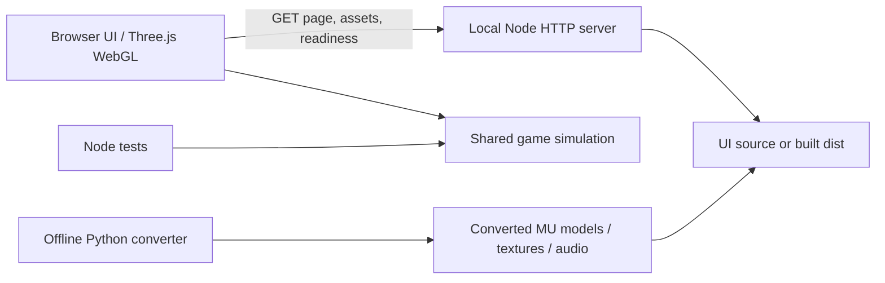
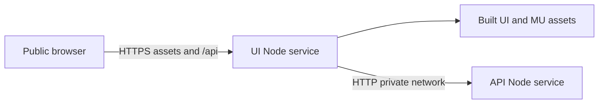

# Local architecture

The local server is the entry point. The root `npm start` command builds the UI and launches the server. The UI owns rendering, user input and audio; the shared game package owns simulation. The server owns HTTP delivery and the small API surface. This keeps a future server-backed mode possible without coupling game rules to Three.js or the DOM.

There are no runtime network dependencies, authentication, persistence or database. Each new run creates a fresh in-memory state. Converted assets are ordinary JSON meshes, PNG textures, MP3 music and WAV effects. The build copies these plus vendored Three.js and shared game logic into a self-contained UI directory.

## Deployment architecture

One container can host both roles. In split mode, SERVE_UI=false disables static delivery on the API; INTERNAL_API_URL on the UI proxies same-origin API requests to the private server. No private address reaches browser code. Both roles use one Docker image. /healthz checks the local service; /api/health on the UI verifies the upstream connection. See DEPLOYMENT.md for runtime variables and Railway setup.
