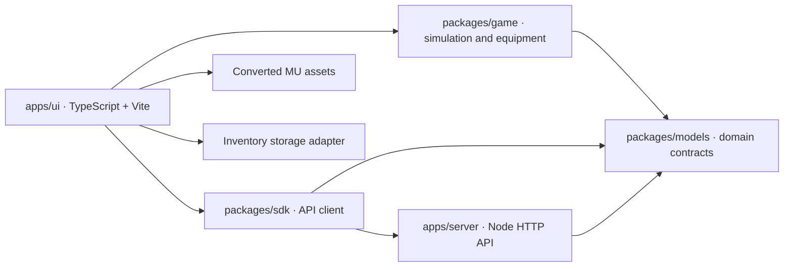
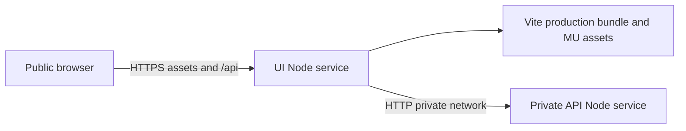

# Application architecture

The browser advances the game at a fixed 60 Hz. UI modules own Three.js rendering, animation, effects, input, native audio and inventory presentation. Shared game modules own simulation, class restrictions, per-slot equipment, automatic pickup, item merging, drop caps and stage rules. No DOM or Three.js enters those rules.

`packages/models` defines the hero/monster IDs, equipment slots, inventory profile, native asset shapes, input, run state, discriminated game events and API responses. `packages/sdk` provides typed service calls, response validation, timeouts and structured HTTP errors. The browser uses it to load demo metadata on startup. `apps/server` serves the built UI and API; gameplay is currently client-side.

## Equipment and persistence

All twelve slots are independently owned: five armor pieces, weapon, shield, two rings, pendant, wings and pet. Equipped armor replaces only that native body part; untouched slots retain the base class body. Weapon meshes attach to the animated hand socket. Enhancement is a property of each item variant, so +13 on one piece never changes the whole outfit.

A pickup enters inventory and auto-equips if its compatible slot is empty. Manually equipped items must be owned and match the hero. Replacing armor recalculates health/defense; replacing weapons recalculates damage without compounding modifiers. Inventory UI pauses active combat, supports equip/unequip and opening boxes, and returns to the previous battle or results screen.

The persistence adapter uses a versioned profile containing inventory items and separate loadouts for the three heroes. Version 3 stores only unequipped items in the bag. Equip and unequip transfer one copy between bag and loadout; replacements return the previous piece to the bag. It migrates older ownership-based saves by removing worn copies from the bag, validates class and slot entries, and saves pickups and equipment changes immediately. The UI inventory adapter scopes this profile to a selected named character and queues authenticated writes to SQLite without changing game/drop logic. Multiple browser tabs are not synchronized live.

## Build and checks

TypeScript uses strict mode throughout. `tsc -b` builds referenced model/game/SDK/server projects with declaration files. The UI is separately type-checked and bundled by Vite. Source lives under `src`; generated output lives under ignored `dist` directories. npm workspaces resolve internal packages, and the lockfile fixes tool/dependency versions.

`npm run dev` runs TypeScript watchers, the API watcher and Vite with a development API proxy. `npm start` builds before serving. `npm run check` runs the same type, lint, format, test and production-build checks used by CI. Tests import compiled packages; HTTP tests use isolated static fixtures.

## Deployment

One container can serve both roles. In split mode, `SERVE_UI=false` disables static delivery on the API; `INTERNAL_API_URL` on the UI proxies same-origin API requests to the private server. The private address is never emitted to browser code. Both roles use one Docker image with compiled server and UI output. `/healthz` checks the local service; `/api/health` through the UI checks its upstream API. See DEPLOYMENT.md.

## Account boundaries

`accounts.ts` adapts HTTP requests, body limits, origin checks and responses. `account-application.ts` owns registration, authentication, character limits and ownership rules. `account-port.ts` defines the application-owned persistence contract; `account-repository.ts` implements it and owns SQLite schema initialization, parameterized SQL and database lifecycle. The composition root wires these at server creation. Database uniqueness constraints and the character-limit trigger protect invariants below the HTTP layer.

`account-session.ts` owns the browser session, selected character and serialized inventory save queue. `account-flow.ts` owns account and roster presentation. Shared account and character response types live in `packages/models`. The existing simulation stays independent of HTTP, SQL and DOM. Future work includes server-authoritative rewards, schema migrations, optimistic concurrency for multiple tabs and persistent character progression.

## Vault transfers and equipment progression

`packages/game/vault` performs pure copy-conserving transfers between a character bag and vault. The application checks character ownership and revision tokens before invoking it. The SQLite repository wraps the profile and vault updates in `BEGIN IMMEDIATE` / commit / rollback. The character revision column is added idempotently for existing databases; account vaults are created lazily. Inventory saves also require the current revision so another tab cannot overwrite a transfer with a stale bag snapshot.

`vault-panel.ts` presents the two containers; `account-session.ts` flushes queued character saves before loading or transferring, then adopts the returned profile and revision. Character bags are always keyed by character ID; only the vault is keyed by account ID. Guest bags use name and class within the current page.

XP is informational progression within a run and emits a level sound without pausing or applying bonuses. Both class skills are initially available. `applyEquipment` derives aura and stat modifiers from worn items, replacing prior equipment modifiers instead of accumulating them. Shared `fitsSlot` supports either ring hand. Original accessory and pet geometry is converted offline and recorded separately from the original world asset provenance.

## World selection and attachment animation

`packages/game/stage` owns the typed six-map catalog and encounter modifiers. A run captures the selected stage, which controls enemy health, damage, spawn rate, species ordering and guardian name. `world-selection.ts` owns dependent World/Map controls, loading state, error recovery and destination labels. The renderer loads assets before replacing the scene, releases the previous terrain geometry/material, and retains shared model/texture caches. World music, fog and ground tint follow the selection. Authored layouts and native asset provenance are recorded in `world-catalog.json`.

`attachments.ts` interpolates weapon, off-hand and upper-spine sockets for locomotion and attack poses. Native wing and companion loops are marked independent of player morph weights, so the character animation cannot overwrite their flap frames. The simulation prevents attacks from starting while movement is requested, roots a cast until its animation ends, and permits dash to cancel the root. These rules are tested independently of rendering.

`companion.ts` updates pets in world space from player position and travel facing, independent of body transforms and skill animation. Runtime companions are detached from the actor hierarchy and explicitly disposed on character replacement; preview companions retain their own animation loop. Wing meshes preserve their original joint origin and are scaled by a target span rather than repositioned bounding boxes.
