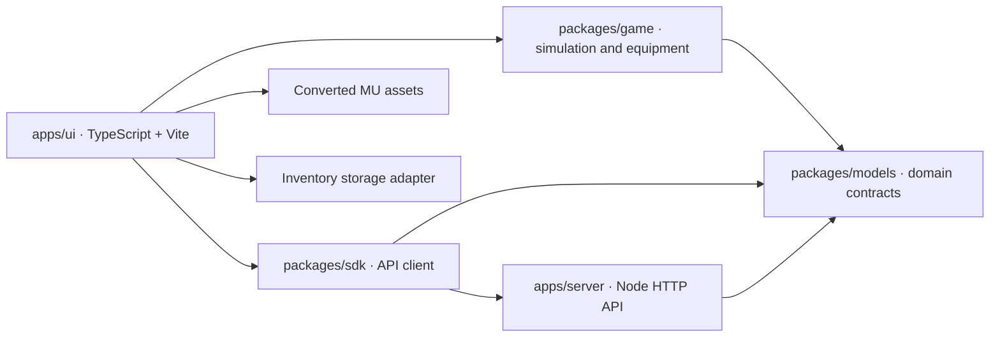
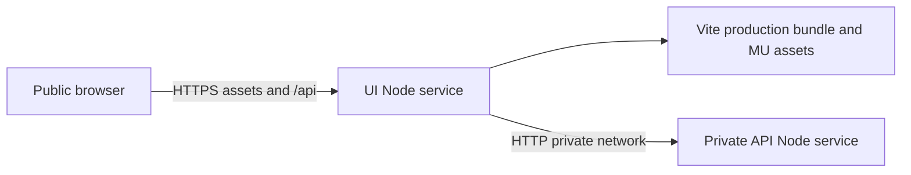

# Application architecture

The browser advances the game at a fixed 60 Hz. UI modules own Three.js rendering, animation, effects, input, native audio and inventory presentation. Shared game modules own simulation, class restrictions, per-slot equipment, automatic pickup, item merging, drop caps and stage rules. No DOM or Three.js enters those rules.

`packages/models` defines the hero/monster IDs, equipment slots, inventory profile, native asset shapes, input, run state, discriminated game events and API responses. `packages/sdk` provides typed service calls, response validation, timeouts and structured HTTP errors. The browser uses it to load demo metadata on startup. `apps/server` serves the built UI and API; gameplay is currently client-side.

## Equipment and persistence

All six slots are independently owned: helm, armor, pants, gloves, boots and weapon. Equipped armor replaces only that native body part; untouched slots retain the base class body. Weapon meshes attach to the animated hand socket. Enhancement is a property of each item variant, so +13 on one piece never changes the whole outfit.

A pickup enters inventory and auto-equips if its compatible slot is empty. Manually equipped items must be owned and match the hero. Replacing armor recalculates health/defense; replacing weapons recalculates damage without compounding modifiers. Inventory UI pauses active combat, supports equip/unequip and opening boxes, and returns to the previous battle or results screen.

The persistence adapter uses a versioned profile containing inventory items and separate loadouts for the three heroes. Version 3 stores only unequipped items in the bag. Equip and unequip transfer one copy between bag and loadout; replacements return the previous piece to the bag. It migrates older ownership-based saves by removing worn copies from the bag, validates class and slot entries, and saves pickups and equipment changes immediately. This implementation is browser-local; a future authenticated service can implement the same contracts without changing game/drop logic. Multiple browser tabs are not synchronized live.

## Build and checks

TypeScript uses strict mode throughout. `tsc -b` builds referenced model/game/SDK/server projects with declaration files. The UI is separately type-checked and bundled by Vite. Source lives under `src`; generated output lives under ignored `dist` directories. npm workspaces resolve internal packages, and the lockfile fixes tool/dependency versions.

`npm run dev` runs TypeScript watchers, the API watcher and Vite with a development API proxy. `npm start` builds before serving. `npm run check` runs the same type, lint, format, test and production-build checks used by CI. Tests import compiled packages; HTTP tests use isolated static fixtures.

## Deployment

One container can serve both roles. In split mode, `SERVE_UI=false` disables static delivery on the API; `INTERNAL_API_URL` on the UI proxies same-origin API requests to the private server. The private address is never emitted to browser code. Both roles use one Docker image with compiled server and UI output. `/healthz` checks the local service; `/api/health` through the UI checks its upstream API. See DEPLOYMENT.md.
